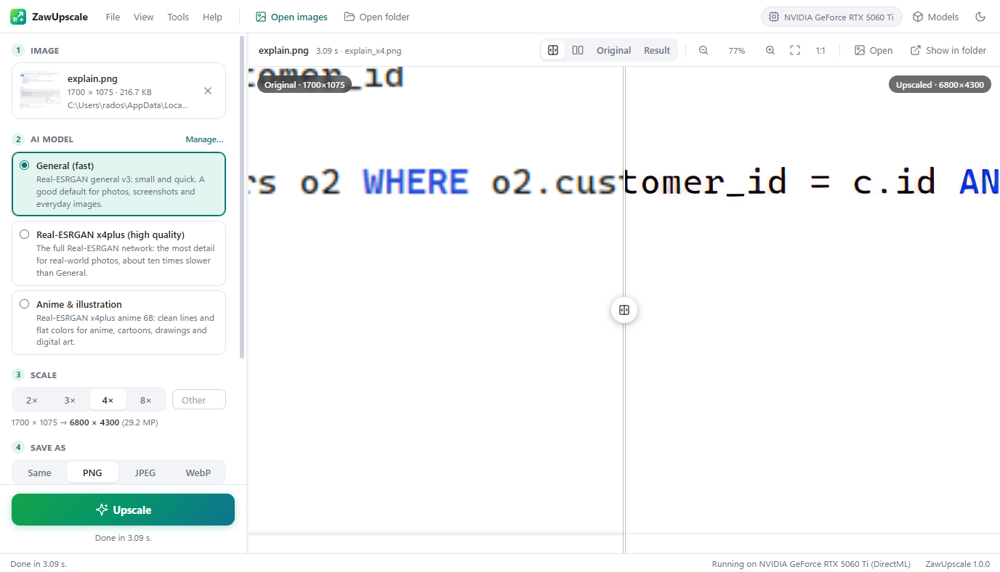

#  ZawUpscale

An AI image upscaler for single images and whole folders, in the spirit of Upscayl, written in C#. A sibling of ZawSQL and ZawHTTP, sharing their architecture and look.

<picture>
  <source media="(prefers-color-scheme: dark)" srcset="assets/screenshots/zawupscale-dark.png">
  
</picture>

The backend is an ASP.NET Core app that runs the AI models with [ONNX Runtime](https://onnxruntime.ai) and reads and writes the images in place. The UI is plain HTML/CSS/JS embedded in the executable. ZawUpscale opens it in a chromeless **app-mode window** of an installed Chromium browser (Chrome, Edge, Chromium or Brave), so it looks and behaves like a desktop window on **Windows, Linux and macOS**. Closing the window quits the app.

## Features

- **One image or a whole folder**: open images (Ctrl+O), a folder (Ctrl+Shift+O, optionally with subfolders), drop files or folders onto the window, or paste an image or a copied path with Ctrl+V.
- **AI models**, downloaded on first use and checked against their SHA-256:
  - **General (fast)**: Real-ESRGAN general v3 (4.6 MB). A good default for photos, screenshots and everyday images.
  - **Real-ESRGAN x4plus (high quality)**: the full network (64 MB), with the most detail for real-world photos. It's about ten times slower.
  - **Anime & illustration**: Real-ESRGAN x4plus anime 6B (17 MB), for clean lines and flat colors.
  - **Your own models**: any ESRGAN-style super-resolution network exported to ONNX (an RGB input `[1, 3, H, W]` in 0–1, float32 or float16). It can take any size or a fixed tile size, and its scale (1×, 2×, 4×…) is detected automatically.
- **Any scale from 1× to 32×**: a 4× model runs several times for 8× or 16×. For in-between scales (2×, 3×, 6×) the result is resized with a high-quality filter, and the image is shrunk *before* the last pass instead of overshooting (6× takes one 4× pass, a reduction to 1.5×, then a 4× pass, not 16× followed by throwing most of it away).
- **GPU acceleration** on Windows through DirectML (any DirectX 12 graphics card: NVIDIA, AMD or Intel), with a choice of GPU. The CPU is used on Linux and macOS, or when you choose it.
- **Images of any size**: they're processed in overlapping tiles (16 px of context on each side, of which only the centre is kept), so there are no seams. If the GPU runs out of memory, the tile size is halved and the image started again automatically.
- **Transparency** is kept: the alpha channel is resized alongside the result. **EXIF orientation** is applied, so phone photos come out the right way up.
- **Compare**: a before/after slider, side by side, or either image alone, with zoom (mouse wheel, 1:1, fit) and pan. When zoomed in to 200% or more, pixels are shown sharply.
- **Batches**: a grid of thumbnails with live progress, status and timing per image. Click a finished image to compare it. One failing image doesn't stop the rest.
- **Output**: the same format as the original, or PNG, JPEG or WebP (with a quality setting, where WebP at 100 is lossless), saved in a subfolder of the opened folder named after the model and scale (`realesr-general-x4v3_x4`), or in a folder of your choice (keeping the subfolder structure either way). Results keep the original's name by default; a pattern can change it, with `{name}`, `{scale}` and `{model}` filled in (`{name}_x{scale}` gives `photo_x4.png`). Existing files can be skipped (so an interrupted batch can simply be run again), overwritten or kept with a number added. Earlier results (those subfolders, or `photo_x4.png` next to `photo.jpg`) aren't picked up as new inputs.
- **Command line**: `ZawUpscale upscale <files or folders>` for scripts (see below).
- **Light and dark themes** (or follow the system), and keyboard shortcuts.

### Keyboard shortcuts

| Keys | Action |
| --- | --- |
| Ctrl+O / Ctrl+Shift+O | Open images / a folder |
| Ctrl+V | Paste an image, or a copied file or folder path |
| Ctrl+Enter | Upscale |
| Esc | Cancel |
| Ctrl+M | Models |
| Ctrl+Shift+E | Show the result in its folder |
| C / S / B / A | Viewer: compare slider, side by side, original, result |
| F or 0 / 1 | Viewer: fit / 100% |
| + / − | Viewer: zoom in / out |
| ← / → | Viewer: move the slider |

## Command line

```sh
ZawUpscale upscale photo.jpg                         # realesr-general-x4v3_x4/photo.jpg
ZawUpscale upscale ~/Pictures/scans -r -s 2 -f png -o ~/Pictures/scans-2x
ZawUpscale upscale art.png -m realesrgan-x4plus-anime -n "{name}-{model}"
ZawUpscale models                                    # list the models (* = installed)
ZawUpscale download realesrgan-x4plus                # download one
```

Options for `upscale`: `-m <model>`, `-s <scale>`, `-o <dir>`, `-f auto|png|jpg|webp`, `-q <quality>`, `-n <pattern>`, `-r` (subfolders), `--overwrite`, `--tile <px>`, `--device auto|cpu|gpu:N`. It shares the models folder with the app (or `--config <dir>`), and exits with code 1 if an image failed.

On Windows the published `ZawUpscale.exe` is a windowed app, so shells don't wait for it by default. In `cmd` and batch files use `start /wait ZawUpscale.exe upscale …`; in PowerShell pipe it (`ZawUpscale.exe upscale … | Out-Host`) to see the output and get the exit code. `dotnet run --project src/ZawUpscale -- upscale …` behaves like a normal console program.

## Where things are stored

Everything is kept in the configuration directory (`%APPDATA%\ZawUpscale` on Windows, `~/.config/ZawUpscale` on Linux and macOS, or `--config <dir>`):

| File | Contents |
| --- | --- |
| `models/` | The downloaded models, and your own `.onnx` files |
| `state.json` | Upscale settings, preferences, last folders |
| `inbox/` | Copies of images dropped on or pasted into the window (cleared after a week) |
| `browser/` | The app window's browser profile |

The originals are never changed. Results of dropped and pasted images are saved in `Pictures/ZawUpscale` unless you choose an output folder: the browser doesn't tell the app where a dropped file came from.

## Security

- The backend listens on **127.0.0.1 only**, on a random port.
- Every API call must carry a random per-process token, which is passed to the window in the URL fragment. Other web pages and local programs can't use ZawUpscale to read your files.
- Only image files are served to the window.

## Requirements

- To run a published build: nothing (self-contained), plus a Chromium-based browser for the app window. Without one the UI opens in the default browser.
- For the GPU: Windows 10 or 11 with a DirectX 12 graphics card. Otherwise the CPU is used, which is much slower. For a 1700 × 1075 image at 4×, the General model took 3 s on an RTX 5060 Ti and 17 s on a 16-thread CPU; x4plus took about 4½ minutes on that CPU.
- To build: the [.NET 10 SDK](https://dotnet.microsoft.com/download).

## Run from source

```sh
dotnet run --project src/ZawUpscale
```

On Windows, `run.bat` builds a Release build and starts it; any arguments are passed on (`run.bat --no-browser`).

Options (`ZawUpscale --help`): `--port <n>`, `--no-browser` (print the URL instead of opening a window), `--keep-alive`, `--browser <path>`, `--config <dir>`, `--token <value>`.

## Build standalone executables

```powershell
./publish.ps1                          # all platforms into dist/<rid>/
./publish.ps1 -Runtimes win-x64        # just Windows
```

```sh
./publish.sh linux-x64 osx-arm64
```

The result is a single self-contained file per platform (`ZawUpscale.exe` / `ZawUpscale`), with ONNX Runtime and Skia inside. Windows builds use the DirectML build of ONNX Runtime, the others the CPU build. There is no Intel Mac build, because ONNX Runtime no longer ships one. Pushing a `vX.Y.Z` tag makes CI build all platforms and publish a GitHub release with `SHA256SUMS`.

### App icon

`assets/icon/zawupscale.svg` is the master drawing. `assets/icon/build-icons.ps1` draws the same icon with GDI+ and writes the PNGs, `src/ZawUpscale/zawupscale.ico` and `wwwroot/icon-256.png`:

```powershell
powershell -ExecutionPolicy Bypass -File assets/icon/build-icons.ps1
```

## Tests

```sh
dotnet test ZawUpscale.slnx
```

Unit tests cover tiling (compared pixel for pixel with an exact reference, for many image and tile sizes), multi-pass planning, alpha, cancellation, EXIF orientation, the encoders, output naming and folder scans. Integration tests run the real ONNX Runtime on tiny models that the tests build themselves (a nearest-neighbour `Resize`, float32 and float16, dynamic and fixed size), then the whole backend: jobs, skipping and renaming, per-image errors, uploads, thumbnails and the API token. No network access or downloaded models are needed.

## Project layout

```
src/ZawUpscale/
  Program.cs, AppHost.cs, AppOptions.cs   host, token check, command line options
  BrowserLauncher.cs, Heartbeat.cs        app-mode window; quit when the last window closes
  Api.cs                                  /api endpoints
  Cli.cs                                  the upscale / models / download commands
  Upscaler.cs                             tiling, multi-pass planning, alpha
  Engine.cs                               ONNX Runtime sessions, devices, out-of-memory retry
  Gpu.cs                                  DirectX adapter list (DXGI)
  ModelStore.cs                           model catalog, downloads, custom models
  Jobs.cs                                 the job queue, output names, existing files
  Files.cs                                file browser, folder scans, drops, reveal in folder
  ImageIO.cs                              decoding, encoding, resizing, thumbnails (SkiaSharp)
  wwwroot/                                the UI (embedded into the executable)
    js/app.js                             layout, menus, settings panel, batches, drop and paste
    js/viewer.js                          before / after viewer
    js/filebrowser.js                     open dialogs
    js/tools.js                           models, preferences, about
tests/ZawUpscale.Tests/                   xUnit tests
```

## Credits

The built-in models are [Real-ESRGAN](https://github.com/xinntao/Real-ESRGAN) by Xintao Wang et al. (BSD-3-Clause), in ONNX conversions published on Hugging Face by [jonathanst29](https://huggingface.co/jonathanst29/tinier-upscale-models) and [SkillSafe](https://huggingface.co/skillsafe-ai/realesrgan-x4plus-anime-6b).
